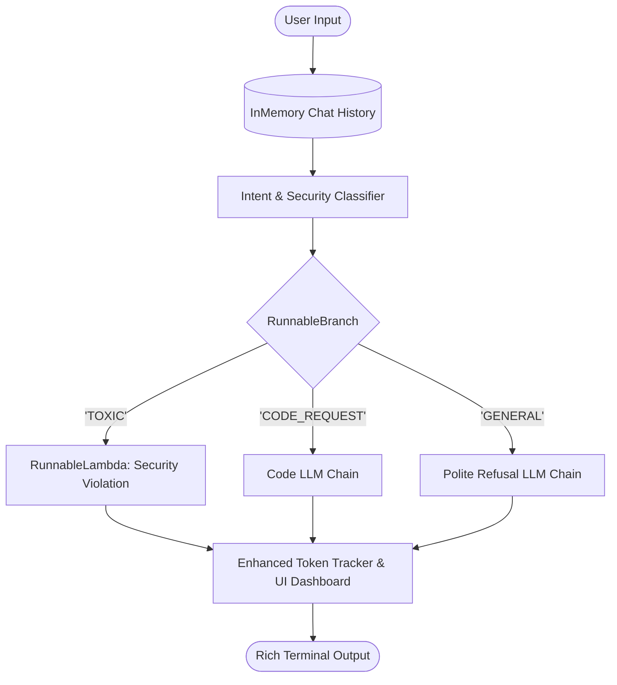

# 🛡️ LangChain Semantic Routing & Guardrails with Gemini 3.8 Flash

This project demonstrates **Semantic Routing**, **Intent Guardrails**, **Conversational Context Retention**, and an **Enhanced Token Tracking Presentation Engine** built using LangChain and Google Gemini 3.8 Flash.

---

## 🏗️ Architecture Overview



---

## 🚀 Key Features

1. **Semantic Router (`RunnableBranch`)**:
   - Routes inputs dynamically to specialized destination runnables based on classified intent.
2. **Strict Guardrail Classification (`classifier_chain`)**:
   - Classifies user inputs strictly into one of 3 labels: `TOXIC`, `CODE_REQUEST`, or `GENERAL`.
3. **Three Specialized Chains**:
   - `toxic_chain`: Uses a `RunnableLambda` to return a hardcoded security response: `"Security Violation: Prompt rejected."` (zero downstream token waste).
   - `code_chain`: Full LLM chain that provides coding and software engineering answers.
   - `general_chain`: Polite refusal chain that declines non-coding questions (e.g., cake baking recipes) and guides the user back to programming topics.
4. **Multi-Turn Conversational Context**:
   - Uses `RunnableWithMessageHistory` and `InMemoryChatMessageHistory` from the word counter pattern to retain conversation history across turns.
5. **Enhanced Token Presentation Engine**:
   - Real-time token usage breakdown (Input Tokens vs Output Tokens vs Total Tokens) for both classifier and destination LLMs.
   - Per-turn latency (`seconds`), word density analysis (`tokens/word`), and response word count.
   - Cumulative session analytics dashboard with route distribution tracking.

---

## 📦 Project Structure

```
guardrail/
├── .env                # API keys (GEMINI_API_KEY / GOOGLE_API_KEY)
├── requirements.txt    # Python dependencies
├── chat_history.py     # Context retention & in-memory session management
├── token_tracker.py    # Enhanced token tracking & Rich dashboard renderer
├── main.py             # Main entry point with router, chains, and test suite
└── README.md           # Documentation
```

---

## ⚡ Quickstart

### 1. Install Dependencies
```bash
pip install -r requirements.txt
```

### 2. Run Automated Test Suite
Runs the 3 required test scenarios (Toxic Prompt, Python Coding Question, Cake Baking Query) plus a Multi-Turn Context Retention verification:
```bash
python main.py
```

### 3. Run Interactive CLI Mode
Test your own prompts interactively:
```bash
python main.py --interactive
```
